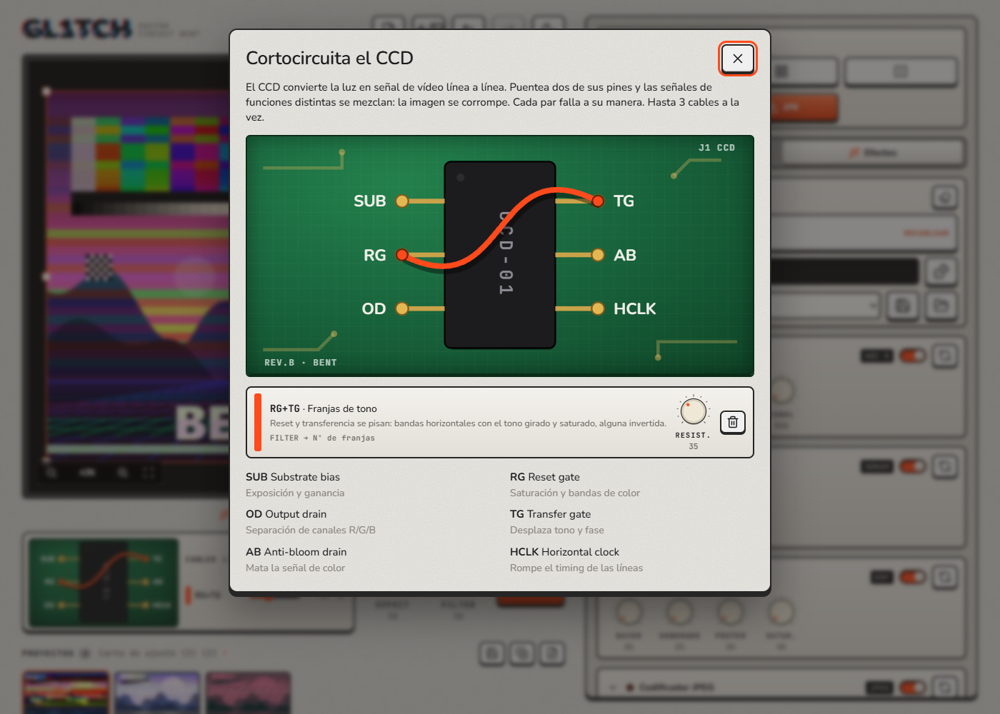
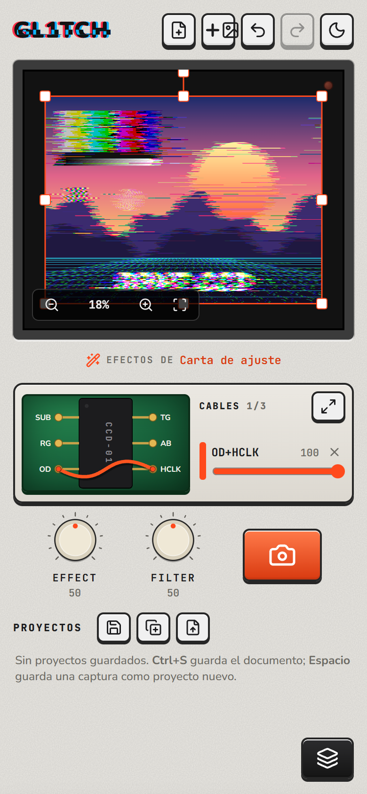
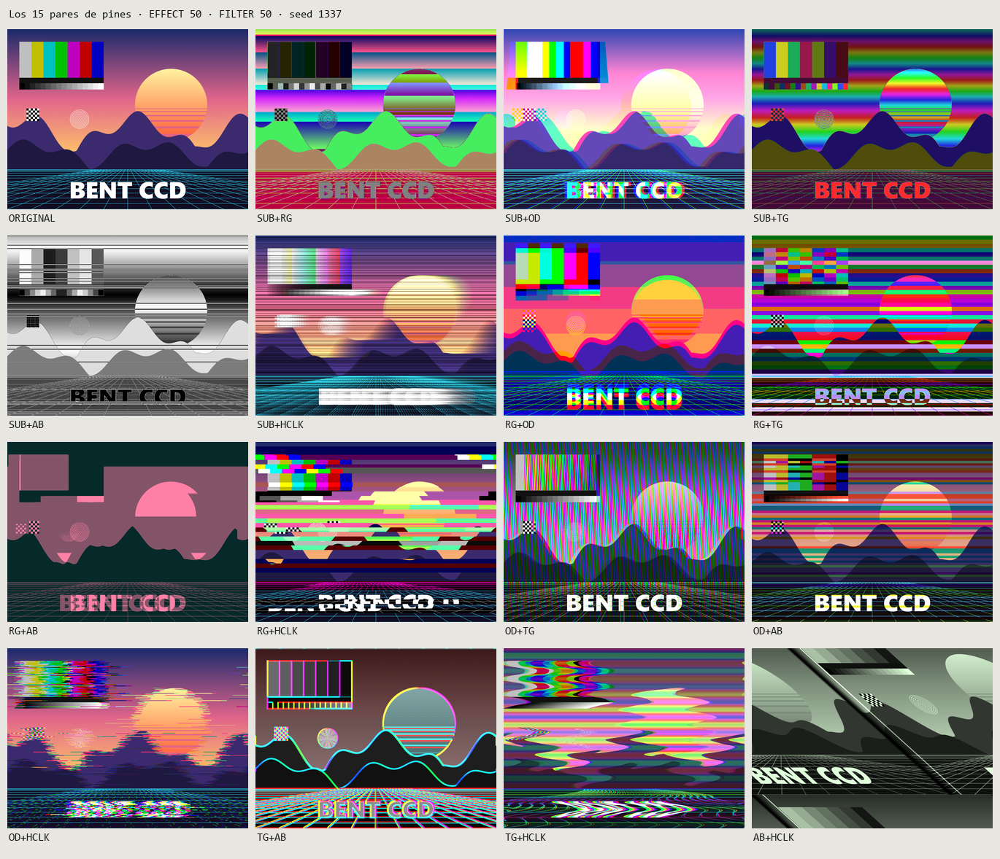

# glitch editor · circuit bent

Editor de fotos **100 % local** que simula el *circuit bending* de una cámara digital. Importas una foto, **puenteas pines del chip CCD con cables** directamente bajo la imagen y giras knobs. Ninguna imagen sale de tu equipo: todo se procesa en el navegador (WebGL2 + Web Worker), sin servidor ni peticiones de red.

Inspirado en [Glitchy Camera](https://glitchycam.com), llevado a la edición de fotos importadas: varios cables a la vez, etapas extra de la cadena de señal, seed reproducible y exportación a resolución completa.


| Mini chip: un cable nuevo bajo la imagen | Vista ampliada: el mismo cable | Móvil (390 px) |
|---|---|---|
|  |  |  |

## Arrancar

Requisitos: Node 18+ y un navegador con WebGL2 (Chrome, Edge, Firefox, Safari recientes).

```bash
npm install
npm run dev            # http://localhost:5173
```

Otras órdenes:

```bash
npm run build          # carpeta estática en dist/ (sírvela con `npm run preview`)
npm run build:single   # un único archivo: dist-single/index.html (se abre con doble clic)
npm test               # tests unitarios (vitest)
```

## Cómo se usa

1. **Importa** una o varias fotos: arrástralas, pégalas (Ctrl+V), pulsa el visor o el botón ⇪. **Cada imagen es una capa**; la primera fija el tamaño del lienzo. También puedes probar con la carta de ajuste.
   Mueve, escala y gira las capas directamente en el visor; el glitch se aplica a la composición en vivo.
2. Bajo el visor está el **mini chip CCD-01**: **arrastra de un pin a otro** (o toca dos pines) para puentearlos y la imagen cambia en el momento. Hasta 3 cables; toca un cable (o su ✕) para quitarlo y ajusta su **resistencia** con el slider de su fila.
   El botón **ampliar** ⤢ (o la tecla W, o «Recablear» en la pestaña Efectos) abre la **vista ampliada**: la misma placa en grande, con la descripción de cada par y un knob de resistencia por cable. Las dos vistas comparten el estado: lo que haces en una aparece al instante en la otra.
3. Gira **EFFECT** (intensidad global) y **FILTER** (carácter: qué hace depende de cada par).
4. En la pestaña **Efectos** del panel derecho están el resumen de cables, seed, presets y los knobs de las **etapas extra** (en móvil, botón del panel). Editan la capa seleccionada o, sin selección, la imagen principal.
5. **Ctrl+S** guarda el proyecto; **Capture** (Espacio) lo guarda como proyecto nuevo; **PNG/JPG** exporta a la resolución original.

### Controles

| Control | Acción |
|---|---|
| Knob | arrastrar ↕ · rueda · flechas/RePág/Inicio/Fin · **Shift** = ajuste fino · **doble clic** o Supr = valor por defecto |
| Cable | en el mini chip o en la vista ampliada: arrastrar entre pines o tocar dos pines (con teclado: Tab hasta el pin + Enter/Espacio) · tocar el cable o ✕ = quitarlo · slider (mini chip) o knob **RESIST.** (vista ampliada) = intensidad de ese cable |
| Interruptor de módulo | bypass de la etapa (el LED se enciende cuando la etapa altera la imagen) |
| **A/B** (o mantener **B**) | ver el original |
| **Aleatorio** (R) | estado aleatorio nuevo |
| **Variantes** (V) | 8 mutaciones cercanas del estado actual; toca una para quedártela |
| **SEED** + dado | todo el ruido depende de la seed: misma seed y mismos ajustes = misma imagen |
| Presets | 6 de fábrica · **Guardar/Cargar** = archivo JSON |
| Proyectos | clic = abrir · doble clic en el nombre = renombrar · ⬇ = PNG a resolución completa · archivo = exportar `.glitch` · papelera = eliminar (dos clics) |
| Menú de la fila de capa | botón ⋯ o clic derecho en la fila: **copiar estilo** / **pegar estilo** (efectos, cables, knobs, etapas, seed, opacidad y fusión) para pasarlo a otra capa · también Ctrl+Alt+C / Ctrl+Alt+V |
| Menú contextual | clic derecho sobre una capa del visor: girar 90° / 180° / enderezar, espejo, copiar, cortar, pegar, duplicar, renombrar, eliminar |
| Atajos | Ctrl+Z / Ctrl+Shift+Z (o Ctrl+Y) · Ctrl+S guardar · Ctrl+Shift+S o Espacio = guardar como nuevo · Ctrl+C / Ctrl+X / Ctrl+V capas · F2 renombrar · I = importar · Esc = cerrar |

### Visor y capas

El visor usa [Konva](https://konvajs.org) (zoom, desplazamiento y asas de transformación) y la lista de capas usa [SortableJS](https://sortablejs.github.io/Sortable/) para reordenar arrastrando (también en táctil).

| Visor | Acción |
|---|---|
| Rueda | zoom hacia el puntero |
| **Ctrl** + rueda / **Alt** (o Shift) + rueda | desplazar en vertical / en horizontal |
| **Ctrl** o **Alt** + arrastrar · botón central | mano (desplazar) |
| Trackpad | pellizco = zoom · dos dedos = desplazar |
| Táctil | dos dedos = pellizco + desplazar |
| `+` `−` · `0` · `1` (también con Ctrl) | zoom · encajar · 100 % |

Al acercar el zoom, la vista previa se vuelve a renderizar a más resolución (hasta 4096 px) para que el glitch se vea nítido.

| Capas | Acción |
|---|---|
| Arrastrar una capa | moverla (flechas = 1 px, Shift+flechas = 10 px) |
| Asas de esquina / lado | escalar (proporcional; **Shift** = libre; **Alt** = desde el centro) |
| Asa superior | girar libre (imanta a 0/90/180/270°; **Shift** = pasos de 15°) |
| `[` `]` · `H` / `Shift+H` | girar 90° · espejo horizontal / vertical |
| Panel | opacidad, modo de fusión (16 modos), X/Y/escala/ángulo numéricos, encajar, rellenar, centrar, 1:1, reset, subir/bajar, duplicar (Ctrl+J), eliminar (Supr), ocultar, bloquear, renombrar (doble clic) |
| Lienzo | ancho/alto, color de fondo, girar 90°, espejo, ajustar a la capa activa o a todas |

### Efectos por capa

**Cada capa tiene sus propios efectos y no hay efectos globales.** Los knobs, los cables, las etapas, la seed, los presets, *Aleatorio* y *Variantes* forman un único editor que siempre trabaja sobre la **capa seleccionada** (debajo del visor pone «Efectos de: …»). Sin capa seleccionada, el editor queda desactivado.

- Una imagen nueva hereda los efectos de la capa activa (la primera usa los de fábrica); una capa de texto empieza limpia.
- La marca de la varita en la lista indica las capas con efectos; el botón de la goma los quita.

Cómo se renderiza (todo en la GPU, en un solo contexto WebGL2):

- Cada imagen se sube **una vez** como textura con mipmaps; mover, escalar o girar una capa solo cambia una matriz.
- Las texturas de trabajo (2 acumuladores, 1 temporal y el par *ping-pong* de pasadas) se **comparten entre todas las capas**.
- Solo las capas con efectos propios guardan una **caché** (a resolución de vista previa), que se invalida cuando cambia esa capa o sus ajustes; al arrastrar una capa solo se recalcula ella. Las cachés tienen un presupuesto de 256 MB con expulsión LRU.
- Los 16 modos de fusión se calculan en un shader (fórmulas de W3C Compositing).
- El codificador (JPEG/pixel sort) de una capa corre en el Worker, conserva el alfa y su resultado se cachea.
- El export procesa **una capa cada vez** y libera sus texturas al terminarla, así que la memoria no crece con el número de capas.

### Capas de texto

Pulsa **T** (o *+ Texto* en el panel) para crear una capa de texto en el centro de lo que estás viendo y escribir directamente. Se mueve, escala, gira y voltea como cualquier capa, y el glitch se le aplica igual.

- **Editar:** doble clic sobre el texto en el visor (o *Editar* en el panel). Intro = salto de línea; Esc, Ctrl+Intro o clic fuera = terminar. Un texto vacío se elimina al salir (Ctrl+Z lo recupera).
- **Panel:** contenido, fuente, tamaño en px, interlineado, color, negrita, cursiva y alineación.
- **Fuentes:** 7 incluidas en la app ([Fontsource](https://fontsource.org): Anton, Bebas Neue, VT323, Press Start 2P, Space Mono, Permanent Marker, Playfair Display), las habituales del sistema, **Fuentes del equipo…** (todas las instaladas, vía Local Font Access API; Chrome/Edge, pide permiso) y **Cargar fuente…** (.ttf, .otf, .woff, .woff2). Ninguna se descarga de internet.
- El texto se dibuja como vector al componer, así que sale nítido al exportar a cualquier resolución.

Las capas y su posición forman parte del historial (Ctrl+Z) y de los proyectos guardados. El export compone las capas a la resolución del lienzo antes de aplicar el glitch.

### Sesión, tema y paneles

- **La sesión se guarda sola** en este navegador (IndexedDB, vía [idb-keyval](https://github.com/jakearchibald/idb-keyval)): capas, imágenes originales, textos, efectos y fuentes cargadas desde archivo. Al recargar o reabrir, todo vuelve. El botón de documento nuevo empieza de cero (Ctrl+Z lo deshace). Tus imágenes no salen del equipo.
- **Proyectos guardados** (base IndexedDB propia): el documento completo (capas y su orden, visibilidad, posición, escala, giro, espejo, opacidad, fusión, textos, efectos y cables de cada capa), las imágenes originales (compartidas entre proyectos) y las fuentes de archivo. Se escribe primero cada imagen y después el proyecto, que se relee para confirmar el guardado. Un proyecto se puede exportar a un único archivo `.glitch` e importar luego, aunque se borren los datos del navegador. Las capturas de la galería de versiones anteriores se convierten en proyectos automáticamente.
- **Tipografía de la interfaz**: Nunito y JetBrains Mono desde Google Fonts (solo los pesos usados). Es la única petición de red de la app; si no carga, se usan fuentes del sistema.
- **Modo oscuro**: botón de luna / sol en la barra superior. Por defecto sigue al sistema y recuerda tu elección.
- **Paneles desplegables**: cada bloque del panel (Herramientas, Capas, Efectos, etapas) y cada sub-bloque de la capa (Texto, Transformar, Lienzo) se pliega con su flecha; se recuerda.
- **Iconos**: [Lucide](https://lucide.dev) (ISC); todos los botones tienen nombre accesible y tooltip con su atajo.

## Pines del CCD

| Pin | Nombre | Efecto base |
|---|---|---|
| SUB | Substrate bias | Exposición y ganancia |
| RG | Reset gate | Saturación y bandas de color |
| OD | Output drain | Separación de canales R/G/B |
| TG | Transfer gate | Desplaza tono y fase |
| AB | Anti-bloom drain | Mata la señal de color |
| HCLK | Horizontal clock | Rompe el timing de las líneas |

## Los 15 pares ↔ efecto

| Par | Modo | Qué pasa "eléctricamente" | FILTER controla |
|---|---|---|---|
| SUB+RG | Overflow de ganancia | La ganancia se dispara y el ADC desborda: las luces vuelven a cero y el color se rompe en bandas | nº de bandas |
| SUB+OD | Split por exposición | R y B se separan más cuanto más brilla la zona | dirección |
| SUB+TG | Fase solar | El tono depende del brillo: solarizado arcoíris | desfase de tono |
| SUB+AB | Quemado mono | Sin color, blancos plegados en negativo, líneas invertidas | punto de pliegue |
| SUB+HCLK | Arrastre de línea | Lo brillante deja estelas a la derecha; cada línea parpadea | longitud de estela |
| RG+OD | Poster partido | Cada canal con pocos niveles y desplazado en vertical | niveles |
| RG+TG | Franjas de tono | Bandas horizontales con el tono girado, alguna invertida | nº de franjas |
| RG+AB | Duotono fantasma | 2-5 niveles, fantasma lateral, dos tintas | tinta |
| RG+HCLK | Desgarro de bloques | Bloques de líneas saltan de lado, se posterizan y cruzan canales | altura de bloque |
| OD+TG | Error de fase NTSC | La crominancia gira en ondas y se adelanta a la luminancia | frecuencia |
| OD+AB | Caída de canal | Por bandas se pierde, duplica o rota un canal | altura de banda |
| OD+HCLK | Jitter RGB | R, G y B tiemblan por separado línea a línea | densidad de líneas |
| TG+AB | Croma de bordes | Imagen gris; solo los bordes tienen color según su orientación | grosor |
| TG+HCLK | Ondulación de sync | Las líneas ondulan y el tono sigue a la onda | frecuencia |
| AB+HCLK | Sync perdido | Imagen inclinada y enrollada, mono, con la barra de sync | deriva vertical |



## Etapas extra (después del CCD)

| Etapa | Knob | Intervención |
|---|---|---|
| **Bus de datos / ADC** | BITS | líneas del bus desconectadas → menos bits por canal |
| | RUIDO | ruido acoplado → bandas con bits invertidos |
| | ROTAR | bus soldado desplazado → bits rotados |
| | CANAL | líneas de canal cruzadas → permutación RGB |
| **Buffer / memoria** | STRIDE | ancho de línea mal programado → imagen cizallada |
| | OVERFLOW | el buffer repite la misma línea en bandas |
| | ECO | lecturas de direcciones vecinas → eco desplazado |
| **Procesador (DSP)** | BAYER | demosaico desalineado → laberinto de color |
| | SANGRADO | filtro de croma roto → el color se corre |
| | POSTER | tabla de gamma truncada |
| | SATUR. | registro de saturación desbordado |
| **Codificador JPEG** | CORRUP. | bytes corruptos reales en el JPEG (por franjas) |
| | CALIDAD | calidad de compresión antes de corromper |
| | GENER. | generaciones de recompresión + corrupción |
| | SORT / TRAMO / DIREC. | pixel sort de los tramos brillantes |


## Cómo funciona

- **WebGL2**: un shader con 4 tipos de pasada (CCD, bus, buffer, DSP) encadenados con framebuffers ping-pong. Cada cable es una pasada.
- **Web Worker**: el codificador corta la imagen en 10 franjas (como los *restart intervals* de una cámara), las codifica en JPEG, corrompe bytes del flujo comprimido (sin tocar cabeceras ni marcadores) y las decodifica. Luego aplica el pixel sort.
- **Determinista**: el azar sale de hashes enteros de `(seed, línea/bloque)` en la GPU y de `mulberry32(seed)` en la CPU.
- **Independiente de la resolución**: los efectos cuentan líneas sobre un raster virtual de 1080 líneas, así que la vista previa (≤1280 px), las miniaturas y el export a resolución completa se ven igual.
- Imágenes de hasta 48 MP (o el límite de texturas de tu GPU); si son más grandes se reducen y la app avisa.

Detalles de diseño en [PLAN.md](PLAN.md).

## Verificación

- `npm test`: PRNG, serialización y saneado de presets, plan de render, aleatorio y variantes deterministas, corrupción JPEG (no rompe cabeceras ni marcadores) y pixel sort (solo reordena).
- `tools/verify.py` (Playwright + Chrome): genera las hojas de contacto de `docs/screenshots/` y comprueba que los 15 pares son distintos entre sí, que cada knob altera la imagen, el determinismo (también tras recargar), la ida y vuelta de presets, la exportación a resolución completa, la importación de JPG/PNG/WebP (cada archivo como capa), el arrastre de cables y knobs, el **mini chip** (crear cable arrastrando y con teclado, slider de resistencia con deshacer, quitar cable, máximo 3, mismo estado que la vista ampliada en ambos sentidos, W abre la vista ampliada), que el visor + mini chip + knobs caben sin scroll a 1400×1000 y 1280×800, que nada desborda a 390 px, deshacer/rehacer, que no hay peticiones de red externas y que no hay errores en consola. Resultado en `docs/screenshots/verificacion.txt`.

```bash
npm run build && npx vite preview --port 4173 &
python3 tools/verify.py
```

Necesita `pip install playwright pillow`; usa el Chrome (o Edge) instalado en Linux o Windows, o el que indique `GLITCH_CHROME`.

### API de depuración
En la consola: `window.__glitch` → `loadSample()`, `getState()`, `setState(s)`, `hash(s?)`, `exportSize()`.

## Limitaciones conocidas

- Con el codificador activo, la vista previa llega unos milisegundos después del giro del knob (se calcula en el worker).
- La corrupción JPEG usa el codificador del navegador: con la misma seed el resultado es idéntico en el mismo navegador, pero puede variar un poco entre motores (Chrome y Firefox).
- Solo imágenes fijas; no hay entrada de cámara ni vídeo.

## Créditos

Interfaz y modelo de pines inspirados en Glitchy Camera de elayabharath (glitchycam.com). La idea de corromper solo los datos de escaneo del JPEG viene de jpg-glitch (snorpey, MIT). Todo el código de este proyecto está escrito desde cero.
# glitch-editor

