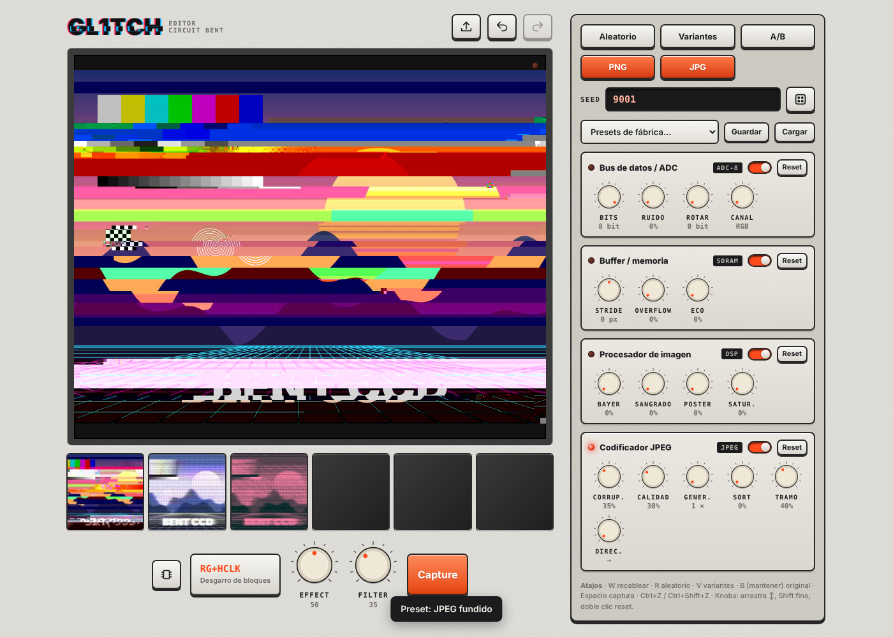
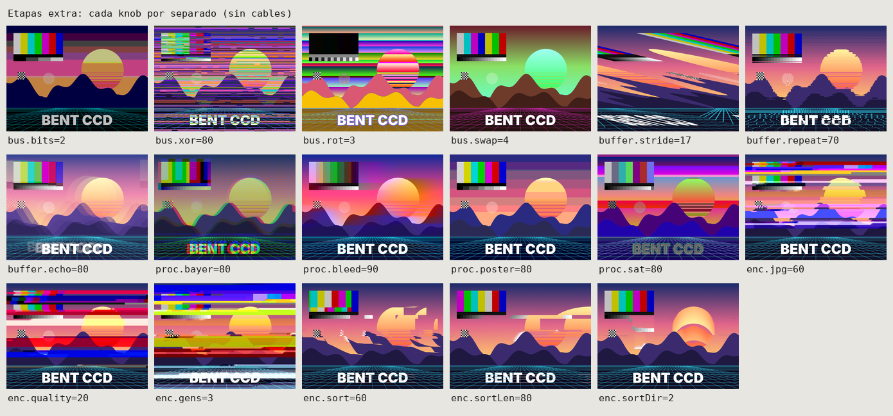

# glitch editor · circuit bent

Editor de fotos **100 % local** que simula el *circuit bending* de una cámara digital. Importas una foto, abres la placa, **puenteas pines del chip CCD con cables** y giras knobs. Ninguna imagen sale de tu equipo: todo se procesa en el navegador (WebGL2 + Web Worker), sin servidor ni peticiones de red.

Inspirado en [Glitchy Camera](https://glitchycam.com), llevado a la edición de fotos importadas: varios cables a la vez, etapas extra de la cadena de señal, seed reproducible y exportación a resolución completa.



## Arrancar

Requisitos: Node 18+ y un navegador con WebGL2 (Chrome, Edge, Firefox, Safari recientes).

```bash
npm install
npm run dev            # http://localhost:5173
```

Otras órdenes:

```bash
npm run build          # carpeta estática en dist/ (sírvela con `npm run preview`)
npm run build:single   # un único archivo: dist-single/index.html (se abre con doble clic)
npm test               # tests unitarios (vitest)
```

## Cómo se usa

1. **Importa** una foto: arrástrala, pégala (Ctrl+V), pulsa el visor o el botón ⇪. También puedes probar con la carta de ajuste.
2. Pulsa el **chip** (o el indicador de cables, o la tecla W) para abrir la placa. **Arrastra de un pin a otro** (o toca dos pines) para puentearlos. Hasta 3 cables; toca un cable para quitarlo.
3. Gira **EFFECT** (intensidad global) y **FILTER** (carácter: qué hace depende de cada par).
4. Activa las **etapas extra** del panel derecho (en móvil, botón *Etapas*).
5. **Capture** guarda el resultado en la galería; **PNG/JPG** exporta a la resolución original.

### Controles

| Control | Acción |
|---|---|
| Knob | arrastrar ↕ · rueda · flechas/RePág/Inicio/Fin · **Shift** = ajuste fino · **doble clic** o Supr = valor por defecto |
| Cable | arrastrar entre pines o tocar dos pines · tocar el cable = quitarlo · knob **RESIST.** = intensidad de ese cable |
| Interruptor de módulo | bypass de la etapa (el LED se enciende cuando la etapa altera la imagen) |
| **A/B** (o mantener **B**) | ver el original |
| **Aleatorio** (R) | estado aleatorio nuevo |
| **Variantes** (V) | 8 mutaciones cercanas del estado actual; toca una para quedártela |
| **SEED** + dado | todo el ruido depende de la seed: misma seed y mismos ajustes = misma imagen |
| Presets | 6 de fábrica · **Guardar/Cargar** = archivo JSON |
| Galería | clic = recuperar los ajustes · ⬇ = descargar PNG a resolución completa |
| Atajos | Ctrl+Z / Ctrl+Shift+Z (o Ctrl+Y) · Espacio = Capture · I = importar · Esc = cerrar |

El último estado se guarda solo en el navegador (localStorage). La imagen no se guarda.

## Pines del CCD

| Pin | Nombre | Efecto base |
|---|---|---|
| SUB | Substrate bias | Exposición y ganancia |
| RG | Reset gate | Saturación y bandas de color |
| OD | Output drain | Separación de canales R/G/B |
| TG | Transfer gate | Desplaza tono y fase |
| AB | Anti-bloom drain | Mata la señal de color |
| HCLK | Horizontal clock | Rompe el timing de las líneas |

## Los 15 pares ↔ efecto

| Par | Modo | Qué pasa "eléctricamente" | FILTER controla |
|---|---|---|---|
| SUB+RG | Overflow de ganancia | La ganancia se dispara y el ADC desborda: las luces vuelven a cero y el color se rompe en bandas | nº de bandas |
| SUB+OD | Split por exposición | R y B se separan más cuanto más brilla la zona | dirección |
| SUB+TG | Fase solar | El tono depende del brillo: solarizado arcoíris | desfase de tono |
| SUB+AB | Quemado mono | Sin color, blancos plegados en negativo, líneas invertidas | punto de pliegue |
| SUB+HCLK | Arrastre de línea | Lo brillante deja estelas a la derecha; cada línea parpadea | longitud de estela |
| RG+OD | Poster partido | Cada canal con pocos niveles y desplazado en vertical | niveles |
| RG+TG | Franjas de tono | Bandas horizontales con el tono girado, alguna invertida | nº de franjas |
| RG+AB | Duotono fantasma | 2-5 niveles, fantasma lateral, dos tintas | tinta |
| RG+HCLK | Desgarro de bloques | Bloques de líneas saltan de lado, se posterizan y cruzan canales | altura de bloque |
| OD+TG | Error de fase NTSC | La crominancia gira en ondas y se adelanta a la luminancia | frecuencia |
| OD+AB | Caída de canal | Por bandas se pierde, duplica o rota un canal | altura de banda |
| OD+HCLK | Jitter RGB | R, G y B tiemblan por separado línea a línea | densidad de líneas |
| TG+AB | Croma de bordes | Imagen gris; solo los bordes tienen color según su orientación | grosor |
| TG+HCLK | Ondulación de sync | Las líneas ondulan y el tono sigue a la onda | frecuencia |
| AB+HCLK | Sync perdido | Imagen inclinada y enrollada, mono, con la barra de sync | deriva vertical |


## Etapas extra (después del CCD)

| Etapa | Knob | Intervención |
|---|---|---|
| **Bus de datos / ADC** | BITS | líneas del bus desconectadas → menos bits por canal |
| | RUIDO | ruido acoplado → bandas con bits invertidos |
| | ROTAR | bus soldado desplazado → bits rotados |
| | CANAL | líneas de canal cruzadas → permutación RGB |
| **Buffer / memoria** | STRIDE | ancho de línea mal programado → imagen cizallada |
| | OVERFLOW | el buffer repite la misma línea en bandas |
| | ECO | lecturas de direcciones vecinas → eco desplazado |
| **Procesador (DSP)** | BAYER | demosaico desalineado → laberinto de color |
| | SANGRADO | filtro de croma roto → el color se corre |
| | POSTER | tabla de gamma truncada |
| | SATUR. | registro de saturación desbordado |
| **Codificador JPEG** | CORRUP. | bytes corruptos reales en el JPEG (por franjas) |
| | CALIDAD | calidad de compresión antes de corromper |
| | GENER. | generaciones de recompresión + corrupción |
| | SORT / TRAMO / DIREC. | pixel sort de los tramos brillantes |



## Cómo funciona

- **WebGL2**: un shader con 4 tipos de pasada (CCD, bus, buffer, DSP) encadenados con framebuffers ping-pong. Cada cable es una pasada.
- **Web Worker**: el codificador corta la imagen en 10 franjas (como los *restart intervals* de una cámara), las codifica en JPEG, corrompe bytes del flujo comprimido (sin tocar cabeceras ni marcadores) y las decodifica. Luego aplica el pixel sort.
- **Determinista**: el azar sale de hashes enteros de `(seed, línea/bloque)` en la GPU y de `mulberry32(seed)` en la CPU.
- **Independiente de la resolución**: los efectos cuentan líneas sobre un raster virtual de 1080 líneas, así que la vista previa (≤1280 px), las miniaturas y el export a resolución completa se ven igual.
- Imágenes de hasta 48 MP (o el límite de texturas de tu GPU); si son más grandes se reducen y la app avisa.

Detalles de diseño en [PLAN.md](PLAN.md).

## Verificación

- `npm test`: PRNG, serialización y saneado de presets, plan de render, aleatorio y variantes deterministas, corrupción JPEG (no rompe cabeceras ni marcadores) y pixel sort (solo reordena).
- `tools/verify.py` (Playwright + Chrome): genera las hojas de contacto de `docs/screenshots/` y comprueba que los 15 pares son distintos entre sí, que cada knob altera la imagen, el determinismo (también tras recargar), la ida y vuelta de presets, la exportación a resolución completa, la importación de JPG/PNG/WebP, el arrastre de cables y knobs, deshacer/rehacer, que no hay peticiones de red externas y que no hay errores en consola. Resultado en `docs/screenshots/verificacion.txt`.

```bash
npm run build && npx vite preview --port 4173 &
python3 tools/verify.py
```

### API de depuración
En la consola: `window.__glitch` → `loadSample()`, `getState()`, `setState(s)`, `hash(s?)`, `exportSize()`.

## Limitaciones conocidas

- Con el codificador activo, la vista previa llega unos milisegundos después del giro del knob (se calcula en el worker).
- La corrupción JPEG usa el codificador del navegador: con la misma seed el resultado es idéntico en el mismo navegador, pero puede variar un poco entre motores (Chrome y Firefox).
- Solo imágenes fijas; no hay entrada de cámara ni vídeo.

## Créditos

Interfaz y modelo de pines inspirados en Glitchy Camera de elayabharath (glitchycam.com). La idea de corromper solo los datos de escaneo del JPEG viene de jpg-glitch (snorpey, MIT). Todo el código de este proyecto está escrito desde cero.
