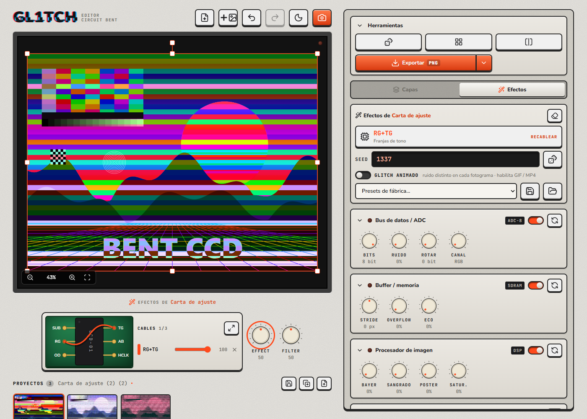
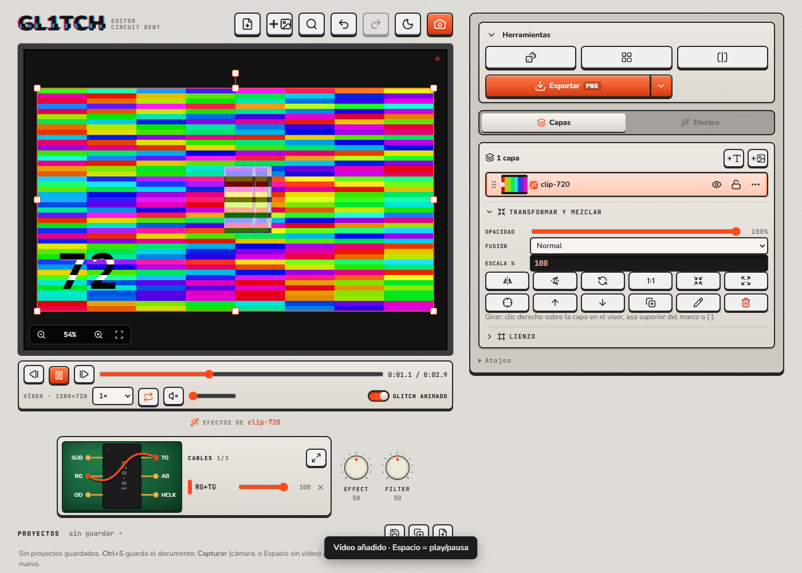
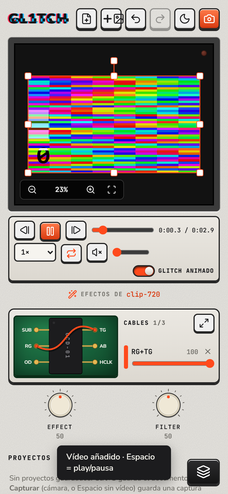
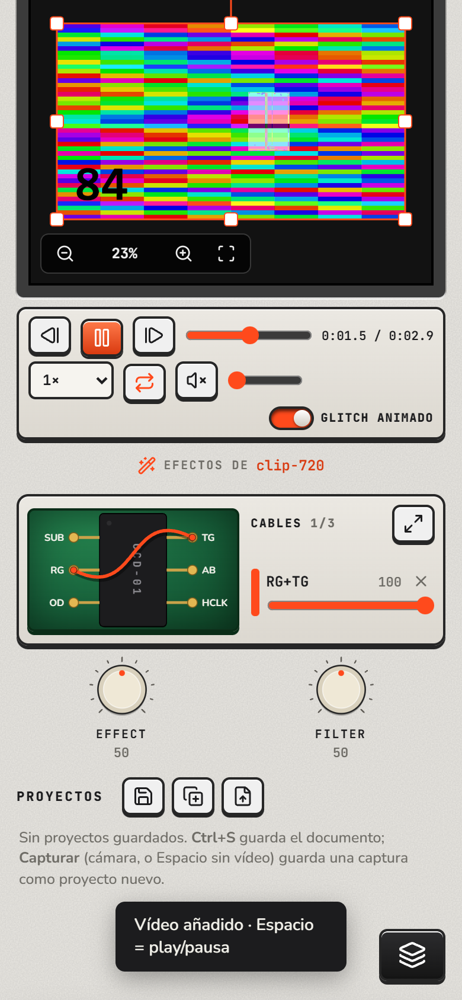
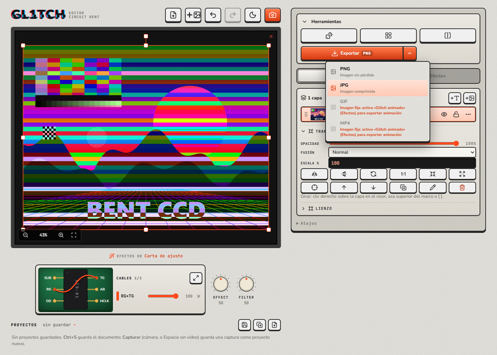
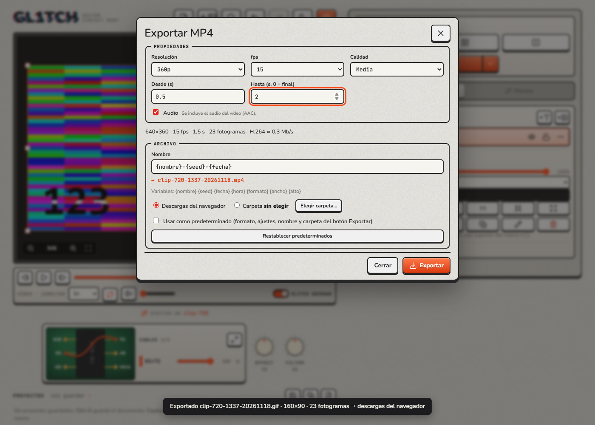
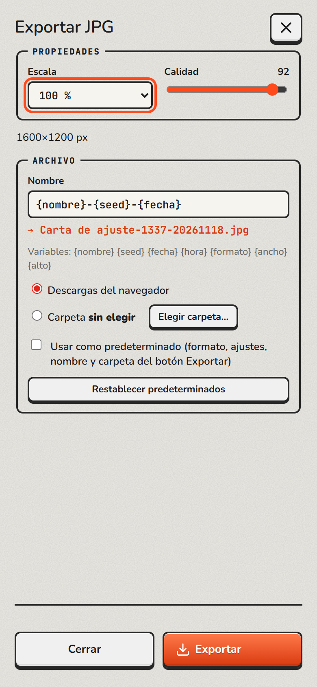
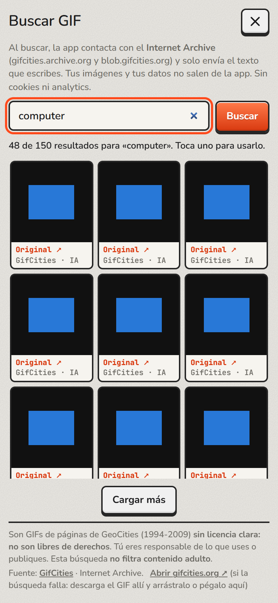

# circuitek · circuit bent

Editor de fotos **100 % local** que simula el *circuit bending* de una cámara digital. Importas una foto, **puenteas pines del chip CCD con cables** directamente bajo la imagen y giras knobs. Ninguna imagen sale de tu equipo: todo se procesa en el navegador (WebGL2 + Web Workers), sin servidor. La única función que usa la red es el [buscador de GIFs](#buscar-gif-gifcities--internet-archive), y solo cuando buscas.

Inspirado en [Glitchy Camera](https://glitchycam.com), llevado a la edición de fotos importadas: varios cables a la vez, etapas extra de la cadena de señal, seed reproducible y exportación a resolución completa.


| Mini chip: un cable nuevo bajo la imagen | Vista ampliada: el mismo cable | Móvil (390 px) |
|---|---|---|
|  |  |  |

**Pruébalo en el navegador:** https://verdux0.github.io/circuitek/ (GitHub Pages; ver [Usarlo en el teléfono](#usarlo-en-el-teléfono)). Para publicarlo en otro sitio (Cloudflare Pages, Netlify Drop o GitHub Pages), ver [docs/DESPLIEGUE.md](docs/DESPLIEGUE.md).

## Arrancar

Requisitos: Node 22.12 o superior (24 LTS recomendado, el que usa la integración continua; lo exige vitest) y un navegador con WebGL2 (Chrome, Edge, Firefox o Safari recientes).

```bash
npm install
npm run dev            # http://localhost:5173
```

Otras órdenes:

```bash
npm run build          # carpeta estática en dist/ (sírvela con `npm run preview`)
npm run build:single   # un único archivo: dist-single/index.html (se abre con doble clic)
npm test               # tests unitarios (vitest)
npm run dev:phone      # servidor en la red local con HTTPS, para el móvil (ver «Usarlo en el teléfono»)
```

## Cómo se usa

1. **Importa** fotos, **GIF animados o vídeos**: arrástralos, pégalos (Ctrl+V), pulsa el visor o el botón ⇪. **Cada archivo es una capa**; la primera fija el tamaño del lienzo. También puedes probar con la carta de ajuste. Los vídeos y GIF se reproducen solos (en silencio) con el glitch aplicado en directo; ver [Vídeo y GIF](#vídeo-y-gif).
   Mueve, escala y gira las capas directamente en el visor; el glitch se aplica a la composición en vivo.
2. Bajo el visor está el **mini chip CCD-01**: **arrastra de un pin a otro** (o toca dos pines) para puentearlos y la imagen cambia en el momento. Hasta 3 cables; toca un cable (o su ✕) para quitarlo y ajusta su **resistencia** con el slider de su fila.
   El botón **ampliar** ⤢ (o la tecla W, o «Recablear» en la pestaña Efectos) abre la **vista ampliada**: la misma placa en grande, con la descripción de cada par y un knob de resistencia por cable. Las dos vistas comparten el estado: lo que haces en una aparece al instante en la otra.
3. Gira **EFFECT** (intensidad global) y **FILTER** (carácter: qué hace depende de cada par).
4. En la pestaña **Efectos** del panel derecho están el resumen de cables, seed, presets y los knobs de las **etapas extra** (en móvil, botón del panel). Editan la capa seleccionada o, sin selección, la imagen principal.
5. **Ctrl+S** guarda el proyecto; **Capturar** (la cámara de la barra superior, a la derecha del modo claro/oscuro; o Espacio si no hay vídeo) lo guarda como proyecto nuevo; **Exportar ▾** (panel Herramientas) guarda PNG, JPG, GIF o MP4 (ver [Exportar](#exportar)) a la resolución original. Con vídeo, se guarda el fotograma actual.

### Controles

| Control | Acción |
|---|---|
| Knob | arrastrar ↕ · rueda · flechas/RePág/Inicio/Fin · **Shift** = ajuste fino · **doble clic** o Supr = valor por defecto |
| Cable | en el mini chip o en la vista ampliada: arrastrar entre pines o tocar dos pines (con teclado: Tab hasta el pin + Enter/Espacio) · tocar el cable o ✕ = quitarlo · slider (mini chip) o knob **RESIST.** (vista ampliada) = intensidad de ese cable |
| Interruptor de módulo | bypass de la etapa (el LED se enciende cuando la etapa altera la imagen) |
| **A/B** (o mantener **B**) | ver el original |
| **Aleatorio** (R) | estado aleatorio nuevo |
| **Variantes** (V) | 8 mutaciones cercanas del estado actual; toca una para quedártela |
| **SEED** + dado | todo el ruido depende de la seed: misma seed y mismos ajustes = misma imagen |
| Presets | 6 de fábrica · **Guardar/Cargar** = archivo JSON |
| Proyectos | clic = abrir · doble clic en el nombre = renombrar · ⬇ = PNG a resolución completa · archivo = exportar `.glitch` · papelera = eliminar (dos clics) |
| Menú de la fila de capa | botón ⋯ o clic derecho en la fila: **copiar estilo** / **pegar estilo** (estilo de capa —sombras, brillos—, opacidad y fusión) · también Ctrl+Alt+C / Ctrl+Alt+V · **clonar circuito** / **soldar circuito** (todo el circuit bending: cables, knobs, etapas, seed y movimiento) para pasarlo a otra capa · también Ctrl+Alt+Shift+C / Ctrl+Alt+Shift+V |
| Menú contextual | clic derecho sobre una capa del visor: girar 90° / 180° / enderezar, espejo, copiar, cortar, pegar, duplicar, renombrar, eliminar |
| Atajos | Ctrl+Z / Ctrl+Shift+Z (o Ctrl+Y) · Ctrl+S guardar · Ctrl+Shift+S (o Espacio sin vídeo) = Capturar · Ctrl+C / Ctrl+X / Ctrl+V capas · F2 renombrar · I = importar · Esc = cerrar |
| Vídeo / GIF | **Espacio** play/pausa · **,** / **.** fotograma anterior / siguiente · **M** silencio |

### Visor y capas

El visor usa [Konva](https://konvajs.org) (zoom, desplazamiento y asas de transformación) y la lista de capas usa [SortableJS](https://sortablejs.github.io/Sortable/) para reordenar arrastrando (también en táctil).

| Visor | Acción |
|---|---|
| Rueda | zoom hacia el puntero |
| **Ctrl** + rueda / **Alt** (o Shift) + rueda | desplazar en vertical / en horizontal |
| **Ctrl** o **Alt** + arrastrar · botón central | mano (desplazar) |
| Trackpad | pellizco = zoom · dos dedos = desplazar |
| Táctil | dos dedos = pellizco + desplazar |
| `+` `−` · `0` · `1` (también con Ctrl) | zoom · encajar · 100 % |

Al acercar el zoom, la vista previa se vuelve a renderizar a más resolución (hasta 4096 px) para que el glitch se vea nítido.

| Capas | Acción |
|---|---|
| Arrastrar una capa | moverla (flechas = 1 px, Shift+flechas = 10 px) |
| Asas de esquina / lado | escalar (proporcional; **Shift** = libre; **Alt** = desde el centro) |
| Asa superior | girar libre (imanta a 0/90/180/270°; **Shift** = pasos de 15°) |
| `[` `]` · `H` / `Shift+H` | girar 90° · espejo horizontal / vertical |
| Panel | opacidad, modo de fusión (16 modos), X/Y/escala/ángulo numéricos, encajar, rellenar, centrar, 1:1, reset, subir/bajar, duplicar (Ctrl+J), eliminar (Supr), ocultar, bloquear, renombrar (doble clic) |
| Lienzo | ancho/alto, color de fondo, girar 90°, espejo, ajustar a la capa activa o a todas |

### Efectos por capa

**Cada capa tiene sus propios efectos y no hay efectos globales.** Los knobs, los cables, las etapas, la seed, los presets, *Aleatorio* y *Variantes* forman un único editor que siempre trabaja sobre la **capa seleccionada** (debajo del visor pone «Efectos de: …»). Sin capa seleccionada, el editor queda desactivado.

- Una imagen nueva hereda los efectos de la capa activa (la primera usa los de fábrica); una capa de texto empieza limpia.
- La marca de la varita en la lista indica las capas con efectos; el botón de la goma los quita.

Cómo se renderiza (todo en la GPU, en un solo contexto WebGL2):

- Cada imagen se sube **una vez** como textura con mipmaps; mover, escalar o girar una capa solo cambia una matriz.
- Las texturas de trabajo (2 acumuladores, 1 temporal y el par *ping-pong* de pasadas) se **comparten entre todas las capas**.
- Solo las capas con efectos propios guardan una **caché** (a resolución de vista previa), que se invalida cuando cambia esa capa o sus ajustes; al arrastrar una capa solo se recalcula ella. Las cachés tienen un presupuesto de 256 MB con expulsión LRU.
- Los 16 modos de fusión se calculan en un shader (fórmulas de W3C Compositing).
- El codificador (JPEG/pixel sort) de una capa corre en el Worker, conserva el alfa y su resultado se cachea.
- El export procesa **una capa cada vez** y libera sus texturas al terminarla, así que la memoria no crece con el número de capas.

### Capas de texto

Pulsa **T** (o *+ Texto* en el panel) para crear una capa de texto en el centro de lo que estás viendo y escribir directamente. Se mueve, escala, gira y voltea como cualquier capa, y el glitch se le aplica igual.

- **Editar:** doble clic sobre el texto en el visor (o *Editar* en el panel). Intro = salto de línea; Esc, Ctrl+Intro o clic fuera = terminar. Un texto vacío se elimina al salir (Ctrl+Z lo recupera).
- **Panel:** contenido, fuente, tamaño en px, interlineado, color, negrita, cursiva y alineación.
- **Fuentes:** 7 incluidas en la app ([Fontsource](https://fontsource.org): Anton, Bebas Neue, VT323, Press Start 2P, Space Mono, Permanent Marker, Playfair Display), las habituales del sistema, **Fuentes del equipo…** (todas las instaladas, vía Local Font Access API; Chrome/Edge, pide permiso) y **Cargar fuente…** (.ttf, .otf, .woff, .woff2). Ninguna se descarga de internet.
- El texto se dibuja como vector al componer, así que sale nítido al exportar a cualquier resolución.

Las capas y su posición forman parte del historial (Ctrl+Z) y de los proyectos guardados. El export compone las capas a la resolución del lienzo antes de aplicar el glitch.

### Sesión, tema y paneles

- **La sesión se guarda sola** en este navegador (IndexedDB, vía [idb-keyval](https://github.com/jakearchibald/idb-keyval)): capas, imágenes originales, textos, efectos y fuentes cargadas desde archivo. Al recargar o reabrir, todo vuelve. El botón de documento nuevo empieza de cero (Ctrl+Z lo deshace). Tus imágenes no salen del equipo.
- **Proyectos guardados** (base IndexedDB propia): el documento completo (capas y su orden, visibilidad, posición, escala, giro, espejo, opacidad, fusión, textos, efectos y cables de cada capa), las imágenes originales (compartidas entre proyectos) y las fuentes de archivo. Se escribe primero cada imagen y después el proyecto, que se relee para confirmar el guardado. Un proyecto se puede exportar a un único archivo `.glitch` e importar luego, aunque se borren los datos del navegador. Las capturas de la galería de versiones anteriores se convierten en proyectos automáticamente.
- **Tipografía de la interfaz**: Nunito y JetBrains Mono incluidas con [Fontsource](https://fontsource.org) (solo los pesos usados, OFL). La app no hace ninguna petición de red.
- **Modo oscuro**: botón de luna / sol en la barra superior. Por defecto sigue al sistema y recuerda tu elección.
- **Paneles desplegables**: cada bloque del panel (Herramientas, Capas, Efectos, etapas) y cada sub-bloque de la capa (Texto, Transformar, Lienzo) se pliega con su flecha; se recuerda.
- **Iconos**: [Lucide](https://lucide.dev) (ISC); todos los botones tienen nombre accesible y tooltip con su atajo.

## Vídeo y GIF



| Móvil (390 px) | Controles en móvil |
|---|---|
|  |  |

**Formatos:** GIF animado, MP4 (H.264) y WebM (VP8/VP9/AV1), y cualquier otro que decodifique tu navegador (MOV, MKV…). Un GIF de un solo fotograma se trata como imagen. Si el navegador no puede decodificar un archivo (por ejemplo HEVC/H.265 en Chrome sin soporte de hardware, ProRes o un archivo dañado), la app lo dice con el nombre del archivo y no añade la capa.

**Filtro en directo:** cada fotograma entra en el mismo pipeline que las imágenes. Todos los cables y las etapas bus, buffer y procesador se aplican mientras se reproduce. En pausa, mover cualquier knob cambia la imagen al momento. Solo se renderiza cuando hay un fotograma nuevo o cambia algo; en pausa no hay nada en marcha.

**Barra de vídeo** (bajo el visor; controla el vídeo de la capa seleccionada, o el primero del documento):

| Control | Acción |
|---|---|
| ⏮ ⏯ ⏭ | fotograma anterior · play/pausa · fotograma siguiente (**,** · **Espacio** · **.**) |
| Barra de búsqueda | tiempo actual / total (con teclado: flechas, Inicio, Fin) |
| Velocidad | 0,25× a 2× |
| 🔁 | bucle activado/desactivado |
| 🔇 + volumen | silencio (**M**) y volumen. Desactivado en GIF y en vídeos sin audio. El vídeo empieza silenciado (reglas de autoplay) |
| JPEG/SORT: SOLO EN PAUSA | aviso que aparece mientras se reproduce si la capa tiene activo el codificador |

- **Todas las capas son animadas** (imágenes, textos, vídeos y GIF): no hay interruptor. Empiezan **en pausa**, en el estado base, y nunca arrancan solas. **Una sola barra lo mueve todo**: ▶/⏸, búsqueda y ±1 fotograma actúan a la vez sobre el reloj de los efectos y sobre cada vídeo/GIF, y cada fuente da la vuelta a su propia duración. El tiempo de la barra es el del vídeo/GIF seleccionado (o el primero), o el del bucle de efectos si no hay ninguno. Los efectos siguen siempre el reloj de efectos, nunca los fotogramas del GIF, así que añadir un GIF no se lleva la animación de los efectos. Es determinista: el mismo fotograma con la misma seed y los mismos ajustes da los mismos píxeles.
- **Codificador (JPEG + pixel sort) solo en pausa**: cuesta unos 165 ms por fotograma (lectura de la GPU + Worker), así que el vídeo bajaría a unos 5 fps y los fotogramas llegarían tarde. Mientras se reproduce se salta y aparece el aviso; al pausar, capturar o exportar se aplica completo.
- **Capturar** guarda el fotograma actual con los ajustes actuales, a resolución completa, como proyecto (una imagen). **Exportar** en PNG/JPG guarda ese fotograma; en GIF/MP4, la animación (ver [Exportar](#exportar)).
- **Sesión:** al recargar la página el vídeo vuelve (el archivo se guarda en IndexedDB y se reabre sin leerlo entero en memoria). Los **proyectos** y los archivos `.glitch` guardan el fotograma actual como imagen, no el vídeo.
- **Imagen fija animada:** con cualquier capa aparece la barra con **▶/⏸**, **±1 fotograma** y velocidad. ▶ anima el glitch en el editor; ⏸ lo deja en el fotograma actual. Nunca arranca sola, nada entra en el historial de deshacer y, con *reducir movimiento* activado en el sistema, ▶ avisa y no arranca (un segundo ▶ en 5 s la reproduce igualmente). Lo que ves en el fotograma N es **píxel a píxel** el fotograma N del GIF/MP4 exportado: la vista previa y la exportación usan la misma función (`stateAtFrame`, `src/motion.ts`). Con JPEG/pixel sort activo, la animación no se bloquea: se mantiene el último fotograma codificado hasta que llega el siguiente.
- **Movimiento** (panel en Efectos), tres modos:
  - **Parpadeo:** el ruido del glitch cambia en cada fotograma (el antiguo «Glitch animado»).
  - **Deriva suave:** cada parámetro oscila alrededor de su valor con un seno (`base + A·sin(2π·k·i/N + φ)`). Fase y ciclos salen de la seed, y como los ciclos son un número entero el bucle cierra perfecto.
  - **Saltos:** cada pocos fotogramas, algunos parámetros saltan a un valor cercano y se mantienen. También sale de la seed.

  **Intensidad** controla cuánto se alejan los parámetros de su valor; **Velocidad**, los ciclos por bucle (1 a 4) o cada cuántos fotogramas saltan (12 a 2). Las casillas eligen **qué se anima**: EFFECT y FILTER por defecto, más la resistencia de los cables y los knobs de las etapas. El **bucle** dura de 1 a 10 s, a 10, 12,5, 20 o 25 fps (cifras exactas para GIF). Los valores siempre se recortan al rango y al paso de cada knob.

  Mientras suena, **los knobs giran solos** con los valores del fotograma. Si mueves uno, ese valor pasa a ser la base y la animación sigue alrededor de él; solo tu gesto entra en el historial de deshacer.

  Todo sale de (seed, fotograma), sin `Math.random()` ni reloj, y se guarda en el estado y en los presets (esquema v2; los presets y sesiones antiguos se cargan con el movimiento por defecto). Exportar un GIF de una animación generada usa por defecto la duración y los fps del Movimiento, así que **cada fotograma del GIF es el mismo que ves en el editor**. El MP4 usa el mismo bucle con sus propios fps.
- **Rendimiento de la animación** (misma GPU AMD, cadena de 3 cables + bus + buffer + procesador): **19,9 fotogramas por segundo de 20**, sin fotogramas descartados, en los tres modos. Con JPEG/pixel sort activo, la animación sigue a 20 fps y el codificador entrega unos 7 fotogramas por segundo (143 ms cada uno); en pantalla se mantiene el último codificado. Un GIF típico (480×360, 3 s a 20 fps = 60 fotogramas, 128 colores) pesa 2,6-3,1 MB y se exporta en 2-4 s.
- **Rendimiento medido** (Chrome, GPU integrada AMD Radeon, D3D11; cadena de 3 cables + bus + buffer + procesador): **720p: 23–28 fps; 1080p: 29–30 fps**, es decir, todos los fotogramas que entrega el vídeo (29,97 fps), con **8–12 ms** por fotograma. La vista previa se limita a 1280 px, así que 1080p cuesta casi lo mismo que 720p. Con WebGL por software (SwiftShader, el que usa `tools/verify.py`) baja a 2–7 fps.
- **GIF:** se decodifica con `ImageDecoder` (WebCodecs: Chrome, Edge, Firefox 133+, Safari 27.3+ de escritorio). Donde no existe (Safari en iOS) se usa [omggif](https://github.com/deanm/omggif) (MIT, unos 7 KB), con un tope de 192 MB de fotogramas en memoria (por encima, se reducen y se avisa).

## Exportar

| Lista de formatos | Opciones (MP4 desde vídeo) | Móvil |
|---|---|---|
|  |  |  |

En el panel **Herramientas**, **Exportar · PNG ▾**:
- **Exportar** (el botón grande) exporta directamente con el formato y los ajustes **predeterminados**, sin abrir nada. Muestra progreso y botón *Cancelar*.
- **▾** abre la lista de formatos: **PNG, JPG, GIF y MP4**. Los que no tienen sentido con lo cargado salen **desactivados con el motivo** (por ejemplo GIF/MP4 sin ninguna capa con efectos). Se maneja con flechas, Inicio/Fin, Intro y Esc, y en móvil tiene filas de 44 px.
- Al elegir un formato se abre el **diálogo de opciones** (a pantalla completa en móvil):

| Formato | Opciones |
|---|---|
| PNG | escala (25 %–400 %) |
| JPG | calidad (1–100) y escala |
| GIF | ancho máximo, fps, colores (2–256), dithering (ordenado Bayer · Floyd–Steinberg · ninguno), duración, repeticiones (0 = infinito), bucle con vídeo (fundido cruzado · ida y vuelta · recortar), solape del fundido y, en animaciones generadas, el pulso del EFFECT. Muestra el tamaño estimado y avisa si es enorme o si los fps no cuadran con las centésimas del GIF |
| MP4 | resolución (original … 360p), fps, calidad, rango *desde/hasta* (vídeo) o duración (animación generada), y audio. El diálogo dice si el audio se incluye (AAC) o por qué no |

- **Nombre del archivo:** plantilla editable con `{nombre} {seed} {fecha} {hora} {formato} {ancho} {alto}` (por defecto `{nombre}-{seed}-{fecha}`) y vista previa del nombre final. Los caracteres no válidos se sustituyen y nunca se sobrescribe un archivo existente (se añade «(2)»).
- **Ubicación:** en Chrome y Edge, **Elegir carpeta…** (File System Access API). La carpeta se recuerda y el navegador vuelve a pedir permiso cuando caduca. En Firefox y Safari esa API no existe, así que el diálogo avisa de que el archivo va a la carpeta que decida el navegador (normalmente Descargas).
- **Usar como predeterminado** guarda el formato, los ajustes, la plantilla y la carpeta para el botón Exportar. Persiste entre sesiones; **Restablecer predeterminados** vuelve a los de fábrica.
- **Cancelar** en cualquier momento: no queda ningún archivo a medias. En una carpeta se escribe en streaming y no se confirma hasta el final; si cancelas, se descarta y se borra la entrada. Como descarga, no se descarga nada.

**Cómo se exporta:** fotograma a fotograma y fuera de tiempo real, con el mismo pipeline (todas las etapas, incluido JPEG/pixel sort), nunca grabando la pantalla. El resultado no depende de la potencia del equipo, y el mismo estado en el mismo instante da los mismos píxeles: dos exportaciones iguales salen idénticas byte a byte. Los vídeos se leen fotograma exacto con [Mediabunny](https://mediabunny.dev) en vez de buscar en el `<video>`. El GIF se cuantiza y codifica en un **Worker** y se escribe por trozos. La interfaz sigue respondiendo durante la exportación.

**GIF en bucle perfecto:**
- *Animación generada* (imágenes o textos con efectos, sin vídeo/GIF): el ruido de cada fotograma es `frameSeed(seed, i)` con *i* = 0…N−1, y el pulso opcional del EFFECT es `sin(2π·k·i/N)` con *k* ciclos enteros. Todo es periódico con N, así que el último fotograma enlaza con el primero como un paso más.
- *Vídeo de entrada:* **fundido cruzado** (predeterminado), **ida y vuelta** o **recortar al bucle más cercano** (busca el corte, entre la mitad y el final, cuyo fotograma más se parece al primero). El fundido es el predeterminado porque vale para cualquier vídeo y no invierte el movimiento. Durante el solape mezcla el final con el principio, de modo que el salto del último fotograma al primero es un paso normal.
- **Paleta global** (una para toda la animación, con fotogramas de muestra): los colores no saltan entre fotogramas ni en la costura. **Dithering ordenado por defecto:** es estable en el tiempo; Floyd–Steinberg «hierve» de un fotograma a otro.
- Bloque **NETSCAPE2.0** con repeticiones = 0 (infinito) por defecto. Los retardos van en centésimas: con 50, 33,3, 25, 20, 16,7, 12,5 o 10 fps son exactos. Con otros (p. ej. 30 fps) se reparten 3-3-4 cs para que la media sea exacta, y el diálogo lo avisa. Más de 50 fps no es fiable en GIF y se limita.

**Compatibilidad por navegador:**

| | Chrome / Edge | Firefox | Safari |
|---|---|---|---|
| PNG / JPG | sí | sí | sí |
| GIF | sí | sí | sí (en iOS, los GIF de entrada se leen con omggif) |
| MP4 (H.264 + AAC, WebCodecs) | sí (94+; comprobado en Chrome 146 de Windows, también sin interfaz) | 130+, si el sistema tiene H.264; si no, **WebM (VP9)** | 16.4+ (no comprobado) |
| Sin `VideoEncoder` | — | MP4 desactivado con el motivo | MP4 desactivado con el motivo |
| Elegir carpeta | sí (86+) | no: descarga normal, avisado | no: descarga normal, avisado |

## Pines del CCD

| Pin | Nombre | Efecto base |
|---|---|---|
| SUB | Substrate bias | Exposición y ganancia |
| RG | Reset gate | Saturación y bandas de color |
| OD | Output drain | Separación de canales R/G/B |
| TG | Transfer gate | Desplaza tono y fase |
| AB | Anti-bloom drain | Mata la señal de color |
| HCLK | Horizontal clock | Rompe el timing de las líneas |

## Los 15 pares ↔ efecto

| Par | Modo | Qué pasa "eléctricamente" | FILTER controla |
|---|---|---|---|
| SUB+RG | Overflow de ganancia | La ganancia se dispara y el ADC desborda: las luces vuelven a cero y el color se rompe en bandas | nº de bandas |
| SUB+OD | Split por exposición | R y B se separan más cuanto más brilla la zona | dirección |
| SUB+TG | Fase solar | El tono depende del brillo: solarizado arcoíris | desfase de tono |
| SUB+AB | Quemado mono | Sin color, blancos plegados en negativo, líneas invertidas | punto de pliegue |
| SUB+HCLK | Arrastre de línea | Lo brillante deja estelas a la derecha; cada línea parpadea | longitud de estela |
| RG+OD | Poster partido | Cada canal con pocos niveles y desplazado en vertical | niveles |
| RG+TG | Franjas de tono | Bandas horizontales con el tono girado, alguna invertida | nº de franjas |
| RG+AB | Duotono fantasma | 2-5 niveles, fantasma lateral, dos tintas | tinta |
| RG+HCLK | Desgarro de bloques | Bloques de líneas saltan de lado, se posterizan y cruzan canales | altura de bloque |
| OD+TG | Error de fase NTSC | La crominancia gira en ondas y se adelanta a la luminancia | frecuencia |
| OD+AB | Caída de canal | Por bandas se pierde, duplica o rota un canal | altura de banda |
| OD+HCLK | Jitter RGB | R, G y B tiemblan por separado línea a línea | densidad de líneas |
| TG+AB | Croma de bordes | Imagen gris; solo los bordes tienen color según su orientación | grosor |
| TG+HCLK | Ondulación de sync | Las líneas ondulan y el tono sigue a la onda | frecuencia |
| AB+HCLK | Sync perdido | Imagen inclinada y enrollada, mono, con la barra de sync | deriva vertical |


## Etapas extra (después del CCD)

| Etapa | Knob | Intervención |
|---|---|---|
| **Bus de datos / ADC** | BITS | líneas del bus desconectadas → menos bits por canal |
| | RUIDO | ruido acoplado → bandas con bits invertidos |
| | ROTAR | bus soldado desplazado → bits rotados |
| | CANAL | líneas de canal cruzadas → permutación RGB |
| **Buffer / memoria** | STRIDE | ancho de línea mal programado → imagen cizallada |
| | OVERFLOW | el buffer repite la misma línea en bandas |
| | ECO | lecturas de direcciones vecinas → eco desplazado |
| **Procesador (DSP)** | BAYER | demosaico desalineado → laberinto de color |
| | SANGRADO | filtro de croma roto → el color se corre |
| | POSTER | tabla de gamma truncada |
| | SATUR. | registro de saturación desbordado |
| **Codificador JPEG** | CORRUP. | bytes corruptos reales en el JPEG (por franjas) |
| | CALIDAD | calidad de compresión antes de corromper |
| | GENER. | generaciones de recompresión + corrupción |
| | SORT / TRAMO / DIREC. | pixel sort de los tramos brillantes |


## Cómo funciona

- **WebGL2**: un shader con 4 tipos de pasada (CCD, bus, buffer, DSP) encadenados con framebuffers ping-pong. Cada cable es una pasada.
- **Web Worker**: el codificador corta la imagen en 10 franjas (como los *restart intervals* de una cámara), las codifica en JPEG, corrompe bytes del flujo comprimido (sin tocar cabeceras ni marcadores) y las decodifica. Luego aplica el pixel sort.
- **Determinista**: el azar sale de hashes enteros de `(seed, línea/bloque)` en la GPU y de `mulberry32(seed)` en la CPU.
- **Independiente de la resolución**: los efectos cuentan líneas sobre un raster virtual de 1080 líneas, así que la vista previa (≤1280 px), las miniaturas y el export a resolución completa se ven igual.
- Imágenes de hasta 48 MP (o el límite de texturas de tu GPU); si son más grandes se reducen y la app avisa.

Detalles de diseño en [PLAN.md](PLAN.md).

## Buscar GIF (GifCities · Internet Archive)



El botón de la lupa, junto a Importar (atajo **G**), abre un buscador de [GifCities](https://gifcities.org): los más de 4 millones de GIF que el Internet Archive salvó de GeoCities. Tocas uno, se descarga y entra como capa animada, igual que si lo hubieras arrastrado.

- **Búsqueda mientras escribes** (con debounce de 400 ms; la anterior se cancela) o con Intro. 48 resultados cada vez, con **Cargar más**. Estados de carga, sin resultados, error (con *Reintentar*) y sin conexión.
- Cada resultado enlaza a **su página original en la Wayback Machine** y lleva el crédito *Fuente: GifCities · Internet Archive*.
- La descarga muestra el progreso y se puede **cancelar**.
- **Privacidad:** la app no hace ninguna petición hasta que buscas. Entonces contacta con `gifcities.archive.org` (envía solo el texto de búsqueda) y `blob.gifcities.org` (descarga las imágenes), sin cookies, sin `Referer` y sin analytics. Tus imágenes y tus datos no salen de la app.
- **Seguridad:** solo https y esos dominios. Límites de 10 MB por GIF (la descarga se corta al superarlos), 600 fotogramas, 2048 px de lado y tiempo máximo de espera. Nada remoto se inserta como HTML.
- **Derechos:** son GIF de páginas personales de 1994-2009, **sin licencia clara: no son libres de derechos**. Tú eres responsable de lo que uses o publiques. **Esta búsqueda no filtra contenido adulto.**
- **Cómo funciona:** usa la API JSON original de GifCities (`gifcities.archive.org/api/v1/gifsearch`), que permite CORS. La búsqueda nueva de gifcities.org (con filtro de contenido adulto) es HTML sin CORS y no se puede leer desde otra web sin un proxy. La API antigua no está documentada: si un día deja de responder, el panel lo dice y ofrece **Abrir gifcities.org** para descargar el GIF allí y arrastrarlo o pegarlo en la app. Detalles en [PLAN-GIFS.md](PLAN-GIFS.md).

## Usarlo en el teléfono

**1. La página publicada (lo más fácil).** Abre {PAGES} en el navegador del móvil. Es HTTPS, así que funcionan todas las funciones que exigen contexto seguro. Se publica sola en cada push a `main` (`.github/workflows/pages.yml`). La primera vez, el dueño del repositorio tiene que activarla en *Settings → Pages → Build and deployment → Source: GitHub Actions*.
*Estado:* el build se ha comprobado servido bajo `/circuitek/` (sin errores 404, en escritorio y a 390 px). La página publicada y su uso en un móvil real están **sin comprobar**.

**2. Desde tu ordenador, en la red local (para desarrollar).**

```bash
npm install
npm run dev:phone
```

- Arranca Vite en la red local (`--host`) con **HTTPS** y un certificado autofirmado ([@vitejs/plugin-basic-ssl](https://github.com/vitejs/vite-plugin-basic-ssl)), y muestra las direcciones al arrancar:
  ```
  ➜  Local:   https://localhost:5173/
  ➜  Network: https://192.168.1.180:5173/
  ```
- El móvil y el ordenador tienen que estar **en la misma Wi-Fi**. Abre en el móvil la dirección *Network* de tu Wi-Fi; si salen varias, las de adaptadores virtuales (WSL, VirtualBox, Docker) no sirven.
- El certificado es autofirmado, así que el navegador avisará: en Chrome para Android, *Configuración avanzada → Acceder a… (sitio no seguro)*; en Safari para iOS, *Mostrar detalles → visitar este sitio web*. **(Sin comprobar en un dispositivo real.)**
- Windows puede pedir permiso en el cortafuegos para Node.js la primera vez: permítelo **solo en redes privadas**. **(Sin comprobar.)**
- Por qué HTTPS: por IP de la red local con `http://` el navegador no da contexto seguro, y algunas funciones (portapapeles, guardar en carpeta, almacenamiento persistente) dejan de estar disponibles.
- *Comprobado:* `npm run dev:phone` arranca con HTTPS y muestra las direcciones de red. Abierta por la IP de la LAN desde Chrome con pantalla de 390 px y emulación táctil: contexto seguro, WebGL2, portapapeles y almacenamiento disponibles, la app carga y procesa sin errores.

**3. Un único archivo.** `npm run build:single` genera `dist-single/index.html`, con todo dentro. En el ordenador se abre con doble clic. Abrir archivos locales en el móvil depende del sistema y del navegador (**sin comprobar**); es más fiable usar la opción 1 o la 2.

**En el móvil:** importar desde la galería o la cámara (selector de archivos), pellizcar con dos dedos para hacer zoom, arrastrar capas, mini chip táctil, vídeos con reproducción en línea (empiezan silenciados), buscador de GIF y exportar. En el móvil no se puede elegir carpeta: los archivos van a las descargas del navegador. Si se puede exportar MP4 depende del codificador del teléfono; si no lo hay, la opción sale desactivada con el motivo. Todo esto está **sin comprobar en un dispositivo real**: solo se ha probado con la emulación móvil de Chrome. La app no es instalable como PWA (no tiene manifiesto ni service worker).

## Desplegar

`npm run build` genera `dist/`, una web estática que funciona en la raíz de un dominio o en una subruta (`base: './'`; comprobado con `python tools/verify_paths.py`). La guía paso a paso de los tres métodos, con fuentes y límites, está en **[docs/DESPLIEGUE.md](docs/DESPLIEGUE.md)**:

- **Cloudflare Pages** conectado a GitHub (`wrangler.toml` y `public/_headers` ya incluidos): se publica en cada push.
- **Netlify Drop:** arrastrar `dist` a app.netlify.com/drop, sin conectar nada.
- **GitHub Pages:** el workflow `.github/workflows/pages.yml`, ya configurado. Falta activar Pages en el repositorio.

## Verificación

- `npm test`: PRNG, serialización y saneado de presets, plan de render, aleatorio y variantes deterministas, corrupción JPEG (no rompe cabeceras ni marcadores), pixel sort (solo reordena) y, para vídeo, la seed por fotograma, índice de fotograma ↔ tiempo, estimación de fps, formato del tiempo, límites de velocidad y detección de GIF animado.
- `tools/verify.py` (Playwright + Chrome): genera las hojas de contacto de `docs/screenshots/` y comprueba que los 15 pares son distintos entre sí, que cada knob altera la imagen, el determinismo (también tras recargar), la ida y vuelta de presets, la exportación a resolución completa, la importación de JPG/PNG/WebP (cada archivo como capa), el arrastre de cables y knobs, el **mini chip** (crear cable arrastrando y con teclado, slider de resistencia con deshacer, quitar cable, máximo 3, mismo estado que la vista ampliada en ambos sentidos, W abre la vista ampliada), que el visor + mini chip + knobs caben sin scroll a 1400×1000 y 1280×800, que nada desborda a 390 px, deshacer/rehacer, que no hay peticiones de red externas y que no hay errores en consola. Resultado en `docs/screenshots/verificacion.txt`.
- `tools/verify_gifsearch.py` (lo ejecuta `verify.py`; también funciona solo): el buscador **con la red interceptada** (nada llega al Internet Archive), a 390 px y con emulación táctil. Comprueba cero peticiones al cargar y al abrir el panel, el debounce (una petición por búsqueda), 48 resultados y «Cargar más», enlaces a la Wayback Machine y crédito, miniaturas sin `Referer` y solo de los dominios esperados, los estados sin resultados, error y sin conexión, que el contenido remoto no se ejecuta como HTML, cancelar una descarga, que un GIF se carga como capa animada y que la consola queda limpia. Los tests de `tests/gifsearch.test.ts` usan una respuesta real guardada como fixture y nunca llaman a la red.
- `tools/verify_export.py` (lo ejecuta `verify.py`; también funciona solo): botón y lista (role=menu, teclado, formatos desactivados con su motivo), PNG por defecto (firma, tamaño y nombre de plantilla), JPG desde el diálogo (calidad, escala, vista previa del nombre, se decodifica), predeterminado tras recargar y restablecer, GIF generado y de vídeo con los tres modos de bucle (cabecera, NETSCAPE2.0 infinito, número de fotogramas, retardos, tamaño y **costura último → primero frente al paso normal**), aviso y reparto de retardos a 30 fps, MP4 generado y de vídeo (H.264, tamaño, fps, duración, audio AAC, con el parser de Mediabunny) que se reproduce en un `<video>`, determinismo (dos GIF idénticos byte a byte), exportar a carpeta (una carpeta OPFS en lugar del selector nativo, que Playwright no puede manejar), cancelar MP4 y GIF a mitad sin dejar archivo, interfaz viva durante la exportación, y lista y diálogo en móvil.
- `tools/verify_media.py` (lo ejecuta `verify.py`; también funciona solo): graba en el propio Chrome vídeos de prueba (WebM y MP4 a 720p/1080p con audio, un MP4 con rotación de 90° en los metadatos, un GIF animado y un archivo corrupto; ver `tools/media_fixtures.py`, sin ffmpeg) y comprueba importar, movimiento, pausa + knob, que en pausa no se renderiza en bucle, búsqueda, ±1 fotograma, velocidad, bucle, volumen, silencio, atajos, el aviso del codificador, captura y export a resolución completa, el hash determinista del mismo fotograma, los fps a 720p/1080p, la rotación, GIF con `ImageDecoder` y con omggif (`?gif=omggif`), cambiar entre vídeo e imagen (y deshacer), recargar sin dejar `<video>` colgados, móvil a 390 px, cero errores en consola y cero peticiones externas.

```bash
npm run build && npx vite preview --port 4173 &
python3 tools/verify.py
```

Necesita `pip install playwright pillow`; usa el Chrome (o Edge) instalado en Linux o Windows, o el que indique `GLITCH_CHROME`.

### API de depuración
En la consola: `window.__glitch` → `loadSample()`, `getState()`, `setState(s)`, `hash(s?)`, `exportSize()`.

## Limitaciones conocidas

- Con el codificador activo, la vista previa llega unos milisegundos después del giro del knob (se calcula en el worker).
- La corrupción JPEG usa el codificador del navegador: con la misma seed el resultado es idéntico en el mismo navegador, pero puede variar un poco entre motores (Chrome y Firefox).
- No hay entrada de cámara en directo (sí se puede importar una foto o un vídeo hechos con la cámara del móvil).
- El buscador de GIF depende de una API antigua del Internet Archive sin documentar: puede dejar de funcionar sin aviso (queda el flujo manual), y no filtra contenido adulto.
- Mientras se reproduce no se aplican JPEG ni pixel sort (ver arriba); el resto de la cadena sí.
- El índice de fotograma de un vídeo sale de su tiempo y de los fps estimados (el navegador no da los fps del archivo). En vídeos de fps variable el número puede saltar de dos en dos, pero ±1 siempre va al fotograma anterior o siguiente que se muestra.
- La rotación de los metadatos la aplica el navegador. Comprobado en Chrome con un MP4 de 90°; en Firefox y Safari no se ha probado.
- Vídeos con algún lado mayor que el límite de texturas de la GPU (normalmente 16384 px) se rechazan con un aviso.
- Los proyectos y los `.glitch` guardan el fotograma actual, no el vídeo; la sesión del navegador sí conserva el vídeo.
- **Exportar:** como máximo 3600 fotogramas por GIF/MP4 (aviso a partir de 1500). Exportar es lento a propósito, porque cada fotograma pasa por todo el pipeline, codificador incluido. El MP4 sin carpeta elegida se monta en memoria antes de descargarse (con carpeta va en streaming). El audio solo sale del primer vídeo visible y solo dentro de su duración. Safari y Firefox no se han probado.

## Licencia

[MIT](LICENSE). Las licencias de librerías, fuentes y servicios de terceros están en [THIRD-PARTY.md](THIRD-PARTY.md).

## Créditos

Interfaz y modelo de pines inspirados en Glitchy Camera de elayabharath (glitchycam.com). La idea de corromper solo los datos de escaneo del JPEG viene de jpg-glitch (snorpey, MIT). Todo el código de este proyecto está escrito desde cero.
