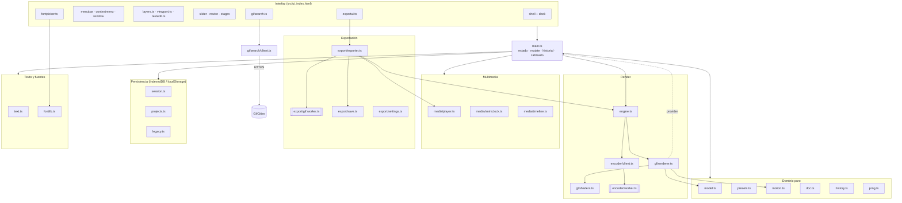
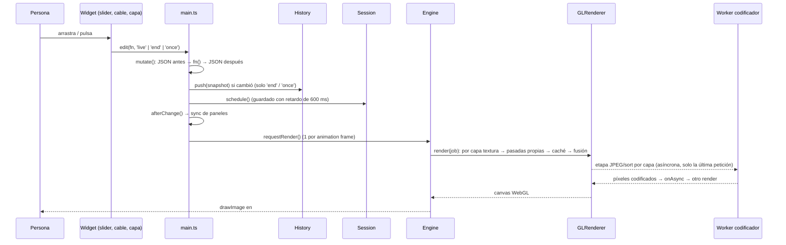

# Visión general de circuitek

> Documento de la Fase 0 de la auditoría (2026-11-23, línea base `7714dc4`, rama
> `refactor/auditoria-circuitec`). Los detalles de cada parte están en `docs/modulos/`. Los
> problemas están en `docs/_estado/HALLAZGOS.md`.

## Qué es

circuitek es un **editor de fotos «glitch» que funciona entero en el navegador**. Simula el
*circuit bending* del sensor CCD de una cámara: se conectan pines del chip con cables virtuales, y
cada par de pines es un efecto de GPU. Detrás hay etapas extra (bus/ADC, memoria, procesador y un
codificador JPEG que corrompe bytes reales). Trabaja con capas (imagen, texto, vídeo, GIF), anima
los efectos y exporta a PNG, JPG, GIF y MP4/WebM. Nada sale del equipo, salvo la búsqueda opcional
de GIF en GifCities (`README.md:1-14`, `src/session.ts:1-8`).

## Stack

| Aspecto | Qué se usa | Evidencia |
|---|---|---|
| Lenguaje | TypeScript estricto (`strict`, `noUnusedLocals`…), ES2022, módulos ES | `tsconfig.json:2-16` |
| Build / dev | Vite 6 (`base: './'`), modos `single` (un único HTML, `vite-plugin-singlefile`) y `phone` (HTTPS autofirmado) | `vite.config.ts:9-24`, `package.json:5-12` |
| Tests | Vitest 5, entorno `node`, `tests/**/*.test.{ts,mjs}` | `vite.config.ts:23` |
| Render | WebGL2 (shaders propios) + Canvas2D / OffscreenCanvas | `src/gl/renderer.ts`, `src/gl/shaders.ts` |
| Hilos | Web Workers incrustados (`?worker&inline`): codificador JPEG y codificador GIF | `src/encoder/client.ts:1`, `src/export/exporter.ts:18` |
| Persistencia | IndexedDB con `idb-keyval` (sesión, proyectos, carpeta de export) y `localStorage` (preferencias) | `src/session.ts`, `src/projects.ts`, `src/export/save.ts` |
| Bibliotecas | Konva (visor), SortableJS (lista de capas), Lucide (iconos), mediabunny (lectura y escritura de vídeo), gifenc (GIF), omggif (decodificar GIF sin `ImageDecoder`), Fontsource (fuentes incluidas) | `package.json:17-34` |
| Servicios externos | Solo GifCities / Internet Archive (búsqueda de GIF, bajo demanda) | `src/gifsearch/client.ts:1-12` |
| Base de datos de servidor | Ninguna: es una web estática | `docs/DESPLIEGUE.md:3` |
| CI/CD | GitHub Actions → GitHub Pages (`tsc`, `npm test`, `npm run build`); Cloudflare Pages (`wrangler.toml`) y Netlify (`public/_headers`) | `.github/workflows/pages.yml`, `wrangler.toml` |
| Herramientas | Python + Playwright: verificación E2E, fixtures de medios, auditoría de diseño; Node: catálogo de fuentes | `tools/*.py`, `tools/fonts/*.mjs` |

## Estructura del repositorio

```
.
├── index.html               HTML de la app: barra de menús, visor, columnas del dock y fuentes de paneles (#panel-sources)
├── src/
│   ├── main.ts              Controlador de la app: estado, mutaciones, historial, cableado de toda la UI
│   ├── model.ts             Dominio: pines, 15 pares, etapas, GlitchState, sanitizado, plan de pasadas de GPU
│   ├── presets.ts · prng.ts Presets de fábrica, aleatorio y variantes; PRNG determinista
│   ├── motion.ts            «Movimiento»: estado del fotograma N (stateAtFrame)
│   ├── doc.ts · history.ts  Documento con capas (transformaciones, fusión) y deshacer / rehacer
│   ├── engine.ts            Orquesta vista previa, miniaturas y export sobre el renderer
│   ├── gl/                  renderer.ts (compositor WebGL2 + caché LRU) · shaders.ts (shader «uber»)
│   ├── encoder/             Etapa del codificador: corrupción JPEG y pixel sort (worker + respaldo)
│   ├── media/               Reproductores de vídeo y GIF, reloj de la animación, línea de tiempo
│   ├── export/              Ajustes, exportador PNG/JPG/GIF/MP4, dithering, worker GIF, destinos de guardado
│   ├── session.ts · projects.ts · legacy.ts   Persistencia (sesión, proyectos, migración de nombres)
│   ├── text.ts · fonts.ts · fontlib.ts        Capas de texto, fuentes incluidas, biblioteca de fuentes
│   ├── gifsearch/client.ts  Cliente de GifCities (validación estricta de lo remoto)
│   ├── ui/                  Componentes de la interfaz (dock, menús, capas, visor, export, fuentes…)
│   ├── sample.ts            Carta de ajuste procedural
│   └── theme.css · styles.css · types/
├── public/                  _headers + fonts/ (biblioteca de 399 familias, catálogo JSON)
├── tests/                   9 archivos Vitest (lógica pura)
├── tools/                   Verificación E2E (Python/Playwright), fixtures, catálogo de fuentes (Node)
├── docs/                    Despliegue, diseño, referencia de UI, capturas, y esta auditoría
└── PLAN*.md · README.md · THIRD-PARTY.md   Planes de cada función, manual y licencias de terceros
```

**Punto de entrada:** `index.html` carga `src/main.ts` como módulo. `main.ts` importa primero
`./legacy` (migra las claves antiguas de `localStorage` antes de que nadie las lea, `src/legacy.ts:1-5`),
después los estilos y las fuentes, y monta la interfaz.

## Arquitectura de alto nivel



**Idea central:** el **documento** (`DocState`, `src/doc.ts:72-81`) es todo el estado editable. Es
serializable y guarda los mapas de bits por clave, así que entra entero en el historial de deshacer.
Cada capa lleva sus propios efectos (`Layer.fx: GlitchState`, `src/doc.ts:57-58`); no hay efectos
globales en la app (`src/engine.ts:2-4`, `src/main.ts:50-54`).

## Flujo de datos

### Edición → vista previa



Cadena de señal de cada capa (orden fijo, `PLAN.md`, `src/gl/renderer.ts:6-20`):
`textura → cable 1 → cable 2 → cable 3 → bus/ADC → buffer → procesador → codificador JPEG (worker) → caché de la capa → modo de fusión → acumulador → canvas`.

### Export

`ExportUI` → `exportStill` / `exportGif` / `exportVideo` (`src/export/exporter.ts`) → un
`GLRenderer` **propio** por export (otro contexto WebGL) → por cada fotograma, `stateAtFrame` (el
mismo que la vista previa) → codificador → `SaveSink` (carpeta elegida o descarga).

### Persistencia

- **Sesión** (`circuitek` / `session`): documento + mapas de bits (`blob:<clave>`) + fuentes del
  usuario (`font:<familia>`). Se guarda con retardo y al ocultar la página (`src/main.ts:2125-2128`).
- **Proyectos** (`circuitek-projects` / `projects`): `p:<id>` + mapas de bits compartidos. Se
  exportan e importan como `.glitch` (JSON con las imágenes en data URLs).
- **Export** (`circuitek-export` / `handles`): la carpeta elegida para exportar.
- **localStorage:** `circuitek:collapsed`, `circuitek:export`, `circuitek.fonts.favs`,
  `circuitek.fonts.recent`, `circuitek:state:v1` (estado antiguo, solo lectura) (`src/legacy.ts:8-16`).

## Cómo se ejecuta, compila y prueba

| Tarea | Comando | Nota |
|---|---|---|
| Desarrollo | `npm run dev` | Vite en `http://localhost:5173` |
| Móvil en la red local | `npm run dev:phone` | HTTPS autofirmado |
| Build | `npm run build` | `tsc --noEmit` + `vite build` → `dist/` |
| Build de un solo archivo | `npm run build:single` | `dist-single/index.html`, sin la biblioteca de fuentes |
| Tests unitarios | `npm test` | `vitest run` |
| Tipado | `npx tsc --noEmit` | también lo hace `build` |
| E2E (rota, ver abajo) | `npx vite preview --port 4173` + `python tools/verify.py` | Chrome + Playwright |
| Prueba de humo (nueva) | `npx vite preview --port 4173` + `python tools/smoke_audit.py` | añadida en esta auditoría |

No hay linter configurado (ni ESLint ni Prettier). El tipado estricto de `tsc` hace ese papel.

## Línea base (2026-11-23, commit `7714dc4`)

| Comprobación | Resultado |
|---|---|
| `npx tsc --noEmit` | ✅ sin errores |
| `npx vitest run` | ✅ **143 / 143 tests** en 9 archivos (≈ 0,4 s) |
| `npx vite build` | ✅ build correcto; aviso: chunks de 536 kB y 796 kB (> 500 kB) |
| `npm audit` | ✅ 0 vulnerabilidades |
| `npm outdated` | 4 menores / parches + vite 6 → 8 (mayor) |
| `python tools/verify.py` (E2E del repositorio) | ❌ **falla al empezar**: espera `#tab-fx`, que ya no existe (H-032) |
| Prueba de humo de la auditoría (14 comprobaciones en Chrome sin cabeza) | ⚠️ **12 / 14**: los 2 fallos son los hallazgos de seguridad H-001 (XSS por la miniatura de un `.glitch`) y H-002 (HTML en el menú contextual) |

**Cobertura aproximada** (no hay herramienta de cobertura, D-004): los tests importan
`prng`, `model`, `presets`, `encoder/bytes`, `history`, `doc`, `text`, `fontlib`, `projects`,
`motion`, `media/timing`, `media/player` (funciones puras), `export/dither`, `export/settings`,
`gifsearch/client` y `tools/fonts/*`. Sin tests: `main.ts`, `engine.ts`, `gl/*`, `session.ts`,
`legacy.ts`, `export/save.ts`, `export/exporter.ts` (salvo lo puro), `encoder/{client,process,worker}.ts`
y todo `ui/`. Por líneas, los archivos con tests directos suman unas 2 700 de las 12 739 líneas
TypeScript de `src/` (≈ 21 %). Es la parte de lógica pura, y está bien cubierta.

## Dependencias

Todas las dependencias de `package.json` se importan en `src/` o se usan en `vite.config.ts`
(comprobado una a una). Ninguna tiene vulnerabilidades conocidas. Versiones nuevas disponibles:
H-026.

## Mapa de documentos de módulo

| Nº | Documento | Archivos |
|---|---|---|
| 01 | [Modelo de efectos, presets y movimiento](modulos/01-modelo-efectos.md) | `model.ts`, `presets.ts`, `prng.ts`, `motion.ts` |
| 02 | [Documento e historial](modulos/02-documento-historial.md) | `doc.ts`, `history.ts` |
| 03 | [Render en GPU](modulos/03-render-gpu.md) | `engine.ts`, `gl/renderer.ts`, `gl/shaders.ts` |
| 04 | [Codificador (etapa JPEG / sort)](modulos/04-codificador.md) | `encoder/*` |
| 05 | [Persistencia](modulos/05-persistencia.md) | `session.ts`, `projects.ts`, `legacy.ts` |
| 06 | [Texto y fuentes](modulos/06-texto-fuentes.md) | `text.ts`, `fonts.ts`, `fontlib.ts`, `ui/fontpicker.ts`, `tools/fonts/` |
| 07 | [Multimedia](modulos/07-multimedia.md) | `media/*` |
| 08 | [Exportación](modulos/08-exportacion.md) | `export/*`, `ui/exportui.ts` |
| 09 | [Búsqueda de GIF](modulos/09-busqueda-gif.md) | `gifsearch/client.ts`, `ui/gifsearch.ts` |
| 10 | [Controlador principal](modulos/10-controlador-main.md) | `main.ts` |
| 11 | [Interfaz](modulos/11-interfaz.md) | `ui/*` (resto), `index.html`, CSS |
| 12 | [Herramientas, CI y despliegue](modulos/12-herramientas-ci.md) | `tools/`, `.github/`, `vite.config.ts`, `public/_headers`, `wrangler.toml` |
